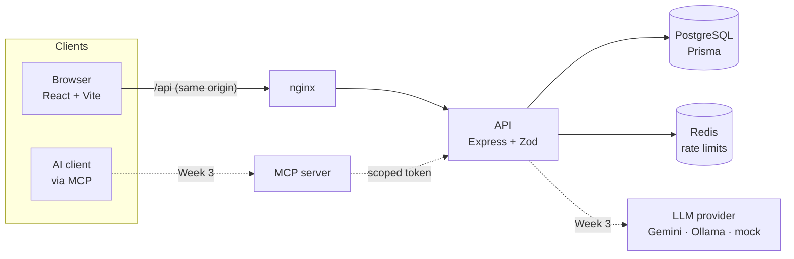

# LearnLoop

Adaptive maths practice for grades 6–8. Students practise with questions that get harder or
easier as they go, teachers see where their class is struggling, and (in progress) an AI agent
and an MCP server let an AI client operate the platform through tools.

It is built as one portfolio repository that shows full-stack, security, testing and DevOps
work end to end. The full specification is the SRS (requirement IDs such as `FR-12` or `SEC-3`
are used throughout the code and tests).

> Status: **pass 1 of 4 done** (SRS weeks 1–2: foundation and core product).
> AI features and the MCP server are next. See [Roadmap](#roadmap).

## The problem

In a class of 30, a teacher cannot tell who is stuck on fractions and who is ready for
harder work until a test goes badly. Students practise at one fixed level, which bores some
and loses others. LearnLoop adapts each practice session to the student and turns the results
into a class view that shows, at a glance, the weakest topics and the students at risk.

## Architecture



The web app and the MCP server both call the same API, so one set of permission checks,
validation rules and audit logging covers every way into the data. Only the API's AI module
talks to the LLM provider.

| Layer     | Choice                                                                                              |
| --------- | --------------------------------------------------------------------------------------------------- |
| Front end | React 18, TypeScript, Vite, React Query, Tailwind CSS, React Router, Recharts                       |
| Back end  | Node 20, Express, TypeScript, Zod, Prisma, PostgreSQL 16, Redis                                     |
| Shared    | `packages/shared`: Zod request schemas and response types used by both sides                        |
| AI        | Provider interface: Gemini free tier, Ollama (local), or a mock for tests                           |
| Quality   | Vitest, Supertest, Testing Library, ESLint, Prettier                                                |
| DevOps    | Docker (multi-stage, non-root), docker compose, GitHub Actions, CodeQL, Trivy, Dependabot, gitleaks |

```
apps/web         React front end
apps/api         Express API, Prisma schema, migrations, seed
apps/mcp-server  MCP server (placeholder until Week 3)
packages/shared  Zod schemas + DTO types shared by web and api
infra            docker-compose, Dockerfiles, nginx
docs/adr         Architecture decision records
```

## Run it

**With Docker (one command, about 3 minutes on a fresh machine):**

```bash
docker compose -f infra/docker-compose.yml up --build
```

Open <http://localhost:8080>. The API applies migrations and seeds demo data on first start.
API docs (OpenAPI, generated from the Zod schemas) are at <http://localhost:8080/api/docs>.

**For development (hot reload):**

```bash
npm install
cp .env.example .env                                   # then set JWT_SECRET
docker compose -f infra/docker-compose.yml up -d postgres redis
npm run db:migrate && npm run db:seed
npm run dev                                            # web :5173, api :4000
```

### Demo accounts

Every account uses the password `LearnLoop!2026`. The login page also has one-click demo buttons.

| Role    | Email                    | Notes                                    |
| ------- | ------------------------ | ---------------------------------------- |
| Student | `student2@learnloop.dev` | In Grade 7 Maths A with practice history |
| Student | `student1@learnloop.dev` | Not in a class: try join code `GRADE7AA` |
| Teacher | `teacher1@learnloop.dev` | Owns Grade 7 Maths A                     |
| Teacher | `teacher2@learnloop.dev` | Owns Grade 8 Maths B (`GRADE8BB`)        |
| Admin   | `admin@learnloop.dev`    | Users and audit log                      |

All data is synthetic: 1 admin, 2 teachers, 30 students and 300 generated questions across 8
topics, each with a computed answer and a worked explanation.

## What's built

**Students** practise a topic in 10-question sessions. Two right answers in a row raise the
level and two wrong lower it (`apps/api/src/services/adaptive.ts`). Each answer gets instant
feedback with a worked explanation. A closed tab resumes on the same question. The progress
page shows mastery per topic, streak, a 14-day accuracy trend and time spent.

**Teachers** create classes with join codes, build quizzes from the question bank, and assign
them to a class or chosen students with a due date. The class dashboard shows average score,
completion, the weakest topics and students at risk, with drill-down to each student's attempt
history and a CSV export.

**Admins** change roles, disable accounts and read a tamper-evident audit log with a one-click
integrity check.

## Security

Security controls are designed in, not added later. [SECURITY.md](SECURITY.md) maps each
control to the code and to the OWASP Top 10. Highlights:

- Argon2id passwords. 15-minute access tokens kept in memory, plus rotating refresh tokens in HttpOnly SameSite=strict cookies. Reusing a refresh token revokes its whole family.
- Every route declares its roles and Zod schemas in one place. Object-level ownership checks stop ID-swapping, and a generated test asserts 401 and 403 for every route × role.
- The audit log is hash-chained and append-only, enforced by a database trigger.
- CSP and security headers, a CORS allow-list, rate limits, and double-submit CSRF.
- CI runs dependency audit, CodeQL, gitleaks secret scanning, and Trivy image scans.

## Tests

```bash
npm test     # 149 tests: shared (15), api (128, 85% line coverage), web (6)
```

API tests run against a real Postgres database (`learnloop_test`, migrated automatically).
`apps/api/test/rbac.test.ts` reads the route table, so every new endpoint is automatically
tested for unauthenticated and wrong-role access (TST-2).
`apps/api/test/access.test.ts` proves that a student cannot read another student's data, and
that a teacher cannot read another teacher's class (TST-3).

## Requirement status

| Area                     | Status  | Notes                                                                          |
| ------------------------ | ------- | ------------------------------------------------------------------------------ |
| Accounts (FR-1..5)       | Done    | Password reset emails are logged to the console in development                 |
| Student (FR-10..17)      | Mostly  | FR-13 shows the stored explanation; AI explanations and FR-14 hints are Week 3 |
| Teacher (FR-20..25)      | Mostly  | FR-21 manual quizzes done; AI-drafted quizzes are Week 3                       |
| Content (FR-30..32)      | Done    | Draft, approved and retired lifecycle                                          |
| Admin (FR-40..42)        | Mostly  | FR-42 AI cost view is Week 3                                                   |
| AI and MCP (AI-1..24)    | Seam    | Provider interface (Gemini, Ollama, mock) in place; features are Week 3        |
| Security (SEC-1..15)     | Done    | SEC-15 encryption at rest depends on the hosting provider                      |
| Data and API (DATA, API) | Done    | OpenAPI at `/api/docs`                                                         |
| DevOps (OPS)             | Partial | CI, scans and images done; E2E, deploy and release automation are Week 4       |
| Testing (TST)            | Partial | TST-1..3, TST-8 done; E2E, axe, AI-output, MCP and k6 tests are Weeks 3–4      |

## Roadmap

- **Week 3, AI and MCP.** Gemini question generation with schema validation and retries, AI explanations and hints (streamed), PII scrubbing, prompt-injection guards, the AI usage and cost view, and an MCP server with 6 tools.
- **Week 4, hardening and release.** Playwright E2E with axe, a k6 performance check, deployment (Vercel + Render), a demo video, and release automation.

## Docs

- [SECURITY.md](SECURITY.md): threat model, controls, OWASP mapping
- [AI-WORKFLOW.md](AI-WORKFLOW.md): how AI tools were used and how their output was checked
- [docs/adr](docs/adr): architecture decision records

## License

MIT
